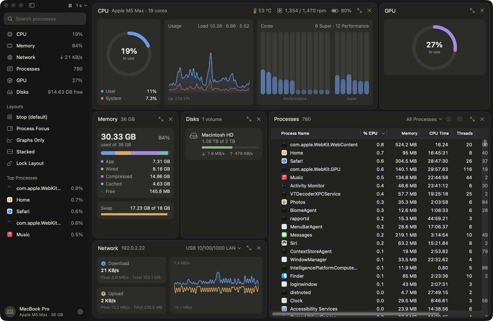
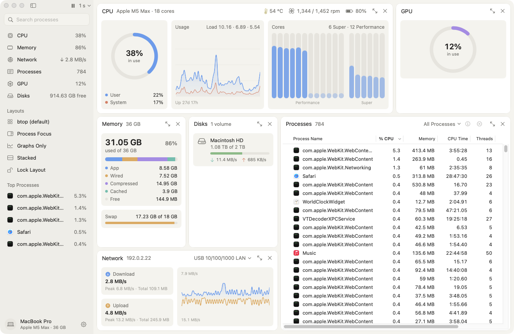
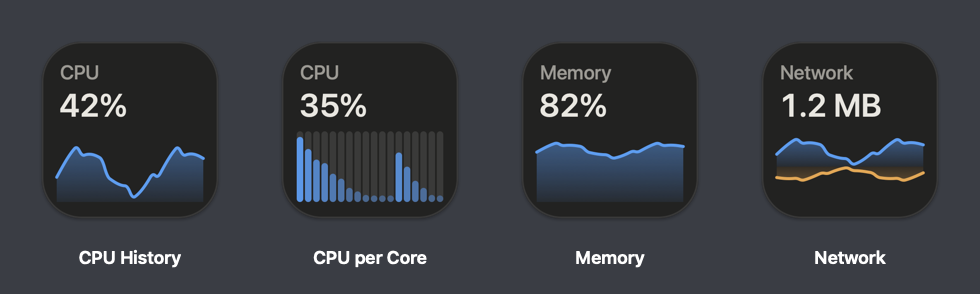
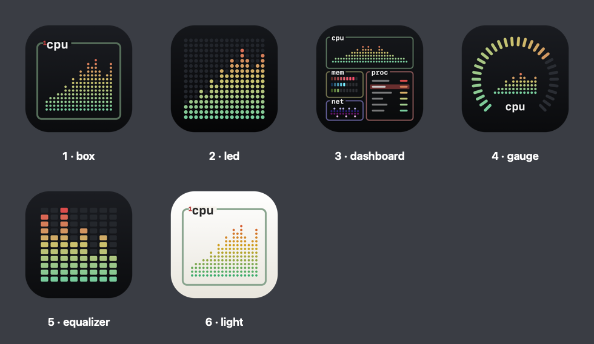

# Boxtop

A native macOS system monitor in SwiftUI, derived from [btop++](https://github.com/aristocratos/btop).





Boxtop is a regular Mac app: a sidebar, flat rounded panes you can rearrange and resize,
charts and gauges, a native process table, light and dark mode, menus, and a Settings window.
Under the hood, the macOS data collection is a port of btop's `src/osx` collectors, and
btop's `.theme` files can color the charts.

## Window

- **Sidebar:** search processes, show or hide panes (each row shows a live value), apply layouts, and see the top processes. At the bottom: the Mac's name and Settings. Toggle it with ⌃⌘S.
- **Panes:** each has a title row (drag it to move the pane) with maximize and hide buttons.
- **Process details:** opens as a side pane. It shows CPU and memory history, parent, start time, CPU time, threads, disk I/O, open files, the full command line, and Quit, Force Quit and Suspend.

| Pane | What it shows |
| --- | --- |
| **CPU** (⌘1) | Usage ring with user/system split, a stacked history chart, load average and uptime. Per-core bars are grouped by cluster on Apple Silicon (Efficiency / Performance / Super, read from the device tree). The header shows temperature, fan speed and battery. |
| **Memory** (⌘2) | Used memory with a storage-bar breakdown (app, wired, compressed, cached, free), pressure, history and swap. |
| **Disks** (⌘6) | One card per Finder-visible volume, with capacity and live read/write rates. |
| **Network** (⌘3) | Download and upload speed, peak and total, and a mirrored history chart. The interface menu uses friendly names (Wi-Fi, Ethernet). Speeds can be shown in bytes or bits. |
| **Processes** (⌘4) | Native table with app icons: % CPU, memory, CPU time, threads, PID, user, command. Click a header to sort; right-click the header to show, hide or reorder columns. Also: tree view, an All / My / Applications / System filter, a context menu, and Activity Monitor-style Quit / Force Quit. |
| **GPU** (⌘5) | Utilization ring and history, clock, power, memory, and fan and temperature where available. Apple Silicon uses IOReport like btop; Intel and AMD GPUs use IOAccelerator statistics. |

### Panes and layout

btop's arrangement is the default, but every pane can be moved and resized:

- **Resize:** drag the gap between two panes. Double-click a gap to split the space evenly.
- **Move:** drag a pane by its title. Drop it on another pane's edge to dock beside it, on its center to swap the two, or on an edge of the window to make it a full-width row or full-height column. An outline shows where it will land.
- **Show and hide:** ⌘1–⌘6, a pane's × button, the sidebar, or Settings → Panes. A hidden pane comes back where it was.
- **Maximize:** double-click a pane's title, or ⌥⌘1–⌥⌘6. ⌥⌘0 restores the layout.
- **Presets:** btop (default), Process Focus, Graphs Only and Stacked, in the sidebar or under View → Layout. **Lock Layout** prevents accidental drags.

Panes adapt to their size: they rearrange their cards, and drop secondary details before anything gets cramped. The layout is saved between launches.

Other features:

- **Appearance:** follows the system, or set Light or Dark.
- **Chart colors:** the default palette, or any of btop's 41 bundled themes. Themes in `~/.config/btop/themes` and `~/Library/Application Support/Boxtop/themes` are picked up automatically.
- **Chart styles:** smooth area (default), bars, or btop's braille-like dots.
- **Screenshot mode** (Settings → General): hides your Mac's name, user name, network addresses, other volumes and third-party processes, so the window can be shared. The screenshots above use it.
- **Menu bar extra** (optional): a CPU sparkline in the menu bar, with a popover listing the top processes.
- **Adjustable update interval** from 250 ms to 10 s. You can also pause updates and change the text size.
- **Live Dock icon** (optional), like Activity Monitor's: CPU history, CPU per core, memory, network or GPU, drawn in btop style. Pick it in Settings → Appearance, or right-click the Dock icon → Dock Icon. You can also show the current value and choose theme colors or btop's default palette.



The window stops drawing whenever it is completely hidden (covered, minimized, or on another Space). Sampling, graph history and the Dock icon keep updating.

## Requirements

- macOS 15 (Sequoia) or later, on Apple Silicon or Intel. The app is a universal binary.
- Xcode 16 or later to build

## Install

Download `Boxtop-<version>.zip` from the Releases page, unzip it and move `Boxtop.app` to `/Applications`.

Release builds are ad-hoc signed, not notarized, so macOS blocks the first launch. Open Boxtop once, then go to System Settings → Privacy & Security and click Open Anyway. Or run:

```bash
xattr -dr com.apple.quarantine /Applications/Boxtop.app
```

## Build

```bash
scripts/build-app.sh
```

This builds a universal release `build/Boxtop.app` (ad-hoc signed). Copy it to `/Applications` if you like.

To build for one architecture only (faster):

```bash
ARCHS=arm64 scripts/build-app.sh
```

For development, run it straight from SwiftPM, or open `Package.swift` in Xcode:

```bash
swift run
```

Run the tests:

```bash
swift test
```

To package a release (universal build, zip and SHA-256 checksum in `dist/`):

```bash
VERSION=1.0.0 scripts/package-release.sh
```

### App icon

`scripts/make-icon.swift` draws six icon designs. To use one as the app icon, pass its name, then rebuild:

```bash
swift scripts/make-icon.swift dashboard
```

To render every design to a folder for comparison:

```bash
swift scripts/make-icon.swift --all /tmp/icons
```



### Checking hardware support

`--diagnose` prints what every collector sees: sensor source, the SMC keys it probed, HID sensors, GPUs, disks and timings. It doesn't open a window, so it works over SSH, which is handy on Intel Macs and hackintoshes:

```bash
/Applications/Boxtop.app/Contents/MacOS/Boxtop --diagnose
```

To install a build on another Mac over SSH (key-based login) and print its diagnostics:

```bash
scripts/deploy-remote.sh user@host
```

## Keyboard

| Keys | Action |
| --- | --- |
| ⌘1 – ⌘6 | Show or hide CPU / Memory / Network / Processes / GPU / Disks |
| ⌥⌘1 – ⌥⌘6, ⌥⌘0 | Maximize a pane, restore the layout |
| ⌃⌘S | Show or hide the sidebar |
| ⌘F | Search processes |
| ⌘I | Show or hide process details |
| ⌫ or ⌘⌫ | Quit the selected process (asks Quit / Force Quit / Cancel) |
| ⌥⌘⌫ | Force quit the selected process |
| ⌘T | Tree view |
| ⌘+ / ⌘− | Faster / slower updates |
| ⌘P | Pause or resume updates |
| ⌥⌘= / ⌥⌘− | Bigger / smaller text |

In the process table, the arrow keys move the selection, and Return or a double-click opens the details.

Quit asks before sending anything. Other terminating signals from the Send Signal menu ask too (you can turn that off in Settings → Processes). Just before sending, Boxtop checks the pid and process start time again, so a recycled pid never receives a signal meant for a process that has exited.

## How it maps to btop

| Boxtop | btop source |
| --- | --- |
| `Sources/CSysInfo/smc.c` | `src/osx/smc.cpp` (Intel temperatures; also fans) |
| `Sources/CSysInfo/hid_sensors.c` | `src/osx/sensors.cpp` (Apple Silicon temperatures) |
| `Sources/CSysInfo/gpu_ioreport.c` | `Gpu::AppleSilicon` in `src/osx/btop_collect.cpp` |
| `Sources/CSysInfo/net_proc.c` | `NET_RT_IFLIST2` counters and `KERN_PROCARGS2` parsing from `Net::collect` and `Proc::collect` |
| `Sources/Boxtop/Collectors/*.swift` | `Cpu`, `Mem`, `Net`, and `Proc` collectors in `src/osx/btop_collect.cpp` |
| `Sources/Boxtop/Theme/Theme.swift` | `Default_theme` and the color fallback rules in `src/btop_theme.cpp` |
| `Resources/themes/` | `themes/` |

All collectors run on one background queue (btop's Runner thread). Each update hands an
immutable sample to a main-actor model, which keeps the graph histories.

### Differences from btop

- **Memory "used"** follows Activity Monitor (app + wired + compressed) instead of btop's active + wired. This makes the numbers match the rest of macOS. Pressure, wired, and compressed memory are shown too.
- **Disks** hides system volumes marked `MNT_DONTBROWSE` (VM, Preboot, Time Machine snapshots, and so on). This matches Finder; there is a setting to show them. For `/`, I/O from all volumes in the APFS volume group (System and Data) is added together. btop only counts the read-only system snapshot there.
- **Temperatures:** btop creates a new HID client on every read. Boxtop caches the client and reads sensors at most every 1.5 s, which keeps fast update intervals cheap.
- **Process state:** macOS reports almost every process as `SRUN`. Boxtop uses the running-thread count to tell running processes from sleeping ones, the way `ps` does.
- **GPU:** btop only supports the Apple Silicon GPU. Boxtop also uses IOAccelerator statistics, so Intel iGPUs and AMD dGPUs show up too.

## Notes and limitations

- **Root-owned processes:** you can't signal processes owned by root or another user. Boxtop shows a clear error, and memory and thread counts for those processes read 0, just like btop run without `sudo`.
- **Apple Silicon CPU frequency** is not available through public interfaces, the same as in btop. Intel Macs show the nominal frequency.
- **Private interfaces:** IOReport and the HID thermal sensors are private macOS APIs, as in btop. They are loaded or declared defensively, and if one is missing the related readings are just hidden. These APIs also mean the app can't go on the Mac App Store, and it is not sandboxed.
- **Intel support:** tested on an Intel desktop (Core i7, AMD Radeon and Intel UHD graphics, macOS 26). The SMC provides CPU package and per-core temperatures and fan speeds, and both GPUs report utilization; the AMD GPU also reports temperature, power, clock, fan and VRAM. Use `--diagnose` to see which sensors your Mac exposes. It hasn't been tested on macOS 15 yet.
- **Rosetta warning:** if you force the Intel slice to run on an Apple Silicon Mac (`arch -x86_64 …`), macOS shows a "won't open on macOS 28" notice, because Rosetta is being retired. Launched normally, the app runs natively and the warning doesn't appear.

## License

Apache License 2.0. Boxtop is a derivative work of btop, Copyright 2021 Aristocratos.
See [LICENSE](LICENSE) and [NOTICE](NOTICE) for which files were derived and how they were changed.
